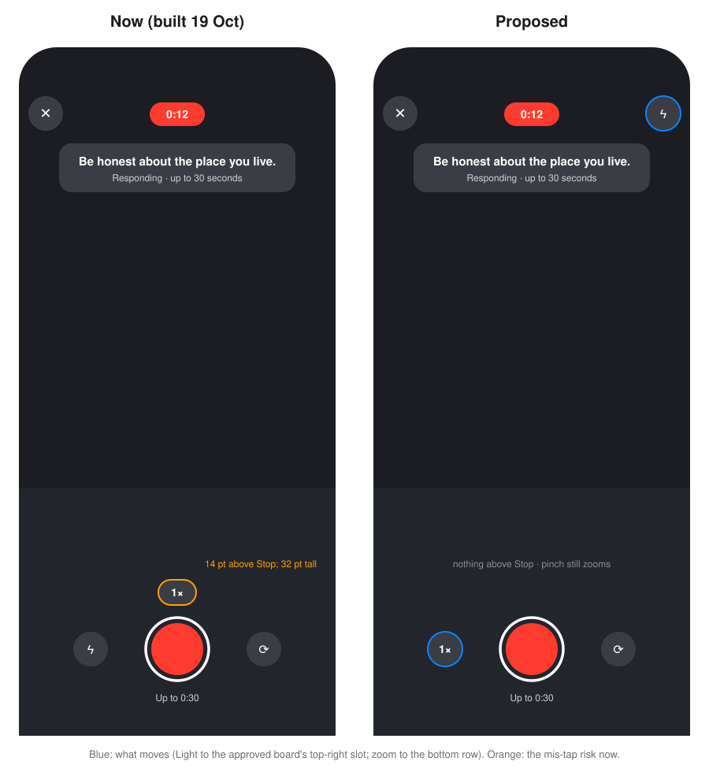

# iPhone stability and interaction fixes (19 Oct 2026, second pass)

Fixes for Nemat's second real-device test on the iPhone 17 Pro (founder Release build `app.shortcut.founder`, hosted project, fingerprint `a64bc144…`, installed 19 Oct).

- **Base:** `c757dfd`, the tip of `claude/conga-iphone-bugs-ux-6cf82a` (the latest Conga commit; checked).
- **Branch:** `claude/conga-iphone-stability-3988b9`, seven commits plus this report.
- **What did not happen:** nothing was pushed, published (no EAS Update), deployed or installed. The hosted project, Mux and the founder's local stack `shortcut` were not touched. The phone was not used.

| Commit | What |
| --- | --- |
| `8f0735a` | Players: progress outside screen state; no listener churn; no stream for the list off screen |
| `56c7001` | Sheets are overlays in the view tree, never `<Modal>`; Discard works at once; P7/P8 is a route |
| `d65ffe8` | Test fix for `56c7001` (typecheck and lint) |
| `b5453dd` | Upload progress and analytics: fewer re-renders and writes |
| `89e06cc` | Record: the timer and ring draw themselves (no 10×/s screen re-render) |
| `e943d2f` | Profiles: swipe between Responses and Replies anywhere on the profile |
| `4b67636` | Respond: say when the member already responded, before the camera; explain the refusal; server field proposed |

## 1. Lag, stutter and taps that did nothing

**Two different causes.**

### 1a. Whole screens stopped taking taps (the cause of "buttons don't respond")

Reproduced on the simulator; see section 2. A React Native `<Modal>` that iOS refused to present left an invisible full-screen layer over the screen. Every tap on it went nowhere, and only a restart cleared it.

- It happens whenever a sheet opens while a native-stack sheet (+, Comments, Replies, Share) is up or still closing.
- On Home, the tab bar kept working, but nothing under it did: the feed, Like, Discard and the banner.
- The camera-entry sheet (P7/P8) sat at the root of the app. Opened from the + sheet, it could block the whole app.

### 1b. Constant JavaScript work while video plays

The players report progress four times a second.

- **Response player:** the progress was screen state, so each report re-rendered the screen, the list, every page and the strip of faces.
  - The pages passed a new callback on every render.
  - So each report also removed and re-added three native listeners per page.
- **Video-reply player:** the screen re-rendered four times a second for a value nothing drew.
- **Home:** each report re-rendered the whole conversation overlay.

Regressions from the 19 Oct swipe change:

- Home keeps both lists (Following, For you) mounted. Every visible row opened its HLS stream, so about twice as many players were buffering at once on mobile data.
- Each banner or Discard state change re-rendered both lists and every row.

Smaller sources:

- Upload progress was reported for every chunk sent, and each report re-rendered everything that reads the posting state.
- Every analytics event wrote the whole queue (up to 1000 events) to storage.
- During a take, the Record screen re-rendered fully, camera view included, ten times a second.

**Fixes** (`8f0735a`, `56c7001`, `b5453dd`, `89e06cc`). No delays added, nothing removed from the screens, copy unchanged.

- Progress lives outside React state (`ui/progress.ts`). Only the 2pt line and the strip's bar redraw.
- `VideoSurface` reads its callbacks through a ref, so listeners are added once per player.
- `VideoSurface` has a `load` flag. The list that is off screen shows stills and opens no stream.
- Conversation, response and reply pages are memoized. Home's two lists are memoized pages with stable props.
- Upload progress is reported per whole percent, which is what the banner shows.
- Analytics writes are batched within 250 ms, and written at once when the app goes to the background.
- The take's timer and ring are their own small components.
- Home's header passes touches outside its tabs and Search, so a swipe can start beside them.

### Measured before and after (iOS simulator)

- **Setup:** iPhone 18 Pro simulator, iOS 27, Debug JavaScript.
- **Before:** an export of `c757dfd`. **After:** this branch.
- **Probe:** a temporary probe (not committed) counted React commits and their render time, and sampled JavaScript event-loop lag every 50 ms. It logged every 5 s.
- **Session:** the same seeded member and the same videos.

| Scenario (per 5 s) | React commits | Render time | Worst JS stall |
| --- | --- | --- | --- |
| Home, video playing, before | 21–24 | 202–301 ms | 35–63 ms |
| Home, video playing, after | 21–22 | 40–45 ms | 23–25 ms |
| Response player, before | 44–47 | 604–756 ms | 51–75 ms |
| Response player, after | 26–31 | 72–81 ms | 20–53 ms |

How to read the table:

- Render work fell about 5× on Home and about 9× in the player.
- Commits on Home are unchanged: the progress line still redraws four times a second, but it is now a two-view leaf.
- The average lag (12–18 ms in both) is the simulator's timer granularity in Debug, not a signal.
- Debug JavaScript is several times slower than Release, so the absolute numbers on the phone will be lower. The ratios are the evidence.

**Not measured:** the Release build on the iPhone. Profiling it needs the phone unlocked and driven, and installing a profiling build needs your approval. Section 7 lists what to check.

## 2. Failed-post banner: Discard did nothing until a restart

### Reproduced

On an isolated local stack, as seed member Adam, with a temporary simulator harness (not committed) that feeds a sample clip to Post Review, because the simulator has no camera:

1. Respond to a prompt Adam already answered, then Post.
   - The server refused with `already_responded`.
   - Home showed "Your response didn't post / This recording can't be posted." with Discard, exactly as on your phone.
2. With the + sheet still on screen or closing, Discard's sheet (P4) was asked to open.
   - iOS logged: "Attempt to present RCTFabricModalHostViewController … which is already presenting RNSScreen".
   - P4 never appeared.
   - After that, neither Discard, Like nor a feed swipe did anything on Home. The tab bar still worked.
3. Only a restart cleared it. That matches your report.

### Root cause

- React Native marks a `<Modal>` presented before iOS agrees, and never hears back.
- A refused modal leaves its full-screen host view mounted and transparent, so it takes every touch.
- Because `onDismiss` never comes, closing it cannot remove it either.

The persisted upload ticket, the busy state and the discard queue were checked and are correct. Discard clears a refused post at once, without asking the server.

### Also found

After a successful Post call, Post Review fired a second `router.replace('/(tabs)')` that raced `dismissTo` back to Home. Seen in the logs; removed.

### Fix (`56c7001`)

- `ui/OverlaySheet`: every confirmation sheet is now an overlay in the screen's own view tree. Nothing for iOS to refuse.
  - Covers P4, P6, P9, PR-Discard, A-Disclosure, LV-CommentOwn and the place unfollow sheets.
  - Fade or slide as before. Android Back closes it.
- Home's P4 and P6 are drawn by the tabs layout, so they cover the tab bar as the boards draw them.
- P7/P8 is a transparent sheet route (`app/camera-blocked`). The native stack opens it over any screen, including the + sheet, and waits for a closing sheet first.
- A test fails if any source file uses `<Modal>` again.

### Verified on the simulator

- The P2 flow, both directly and through the + sheet: Discard opens P4 at once, and confirming clears the banner.
- After closing +: a tap during its fade-out lands on the closing sheet, as on any iOS sheet; the next tap opens P4.
- Like works immediately after.
- P7 opens over the + sheet.
- A post the server had accepted (P1, with an upload id): Discard went through `abandon-submission`, the row became `deleted`, and the fake Mux upload was cancelled.

[01 P4 over the tab bar](screenshots/iphone-stability-19oct/01-discard-sheet-over-tab-bar.jpg)

## 3. Respond on a prompt you have already responded to

### Trusted data that exists today

- `profile_responses` for your own profile (live and processing).
- The server's `already_responded` refusal.
- Your own response going live.

**Gap:** a response a moderator removed still holds the slot (migration `20261016000300`), but `profile_responses` does not list it. Only a server field can say so precisely.

### App (`4b67636`)

- `lib/responded` keeps the prompts you hold the slot on, from the sources above plus `viewer_responded` once deployed.
  - The server's answer wins.
  - Deleting your own video forgets everything except the list, which is then read again.
  - Nothing carries over to another account.
- **The + sheet** shows **Responded** instead of Respond on those prompts.
- **Every Respond** opens a sheet instead of the camera on those prompts: Home, the player, the end card, Me's "Respond to tonight's prompt", Activity.
  - **You've already responded to this prompt**
  - One response per prompt. To record a new one, delete your response first.
  - Video replies and drafts are not affected.
- **The refusal banner** now says why. For `already_responded`, P2's second line is "You've already responded to this prompt." instead of "This recording can't be posted.". Other refusals keep the board's line.
- **The one-response policy is unchanged.** `post_response` still decides; nothing is bypassed.

### Server: prepared, not deployed (`supabase/proposed/`)

`prompt_card` gains `viewer_responded`, using the slot's own predicate:

- kind `response`
- status processing, live or removed

It covers moderator removals and the + sheet's list exactly.

- Files: migration, rollback and pgTAP test.
- On the isolated stack: 14/14, and the existing 1,662 pgTAP tests still pass with it applied.
- **To adopt:** move the files into `migrations/`, `rollback/` and `tests/`, then deploy as usual (`supabase/proposed/README.md`).

### Verified on the simulator

- **Answered prompts:**
  - Adam's two answered prompts show Responded in the + sheet.
  - Respond on one of them shows the sheet.
- **The gap case:** a response marked removed on the local stack only.
  1. Without the field, the + sheet offered it.
  2. Post was refused with the new line.
  3. After that, the + sheet marked it Responded.
  4. With the proposed field applied locally, it was marked Responded straight after a fresh launch.
- **An eligible prompt posts:**
  - `post_response` accepted it and created the row (processing).
  - The upload then went to a **fake** Mux on this Mac, so it failed as designed (P1 Retry banner) and **no real Mux asset was created.**

[02 + sheet](screenshots/iphone-stability-19oct/02-plus-sheet-responded.jpg) · [03 Respond on an answered prompt](screenshots/iphone-stability-19oct/03-respond-already-responded.jpg) · [04 refusal banner](screenshots/iphone-stability-19oct/04-refusal-banner-explains.jpg)

## 4. Swiping on Me and other profiles

### Cause

- The pager wrapped only the grid, and was only as tall as the grid, inside the profile's vertical scroll.
- So the header, the tabs and the empty space under a short grid could not start a swipe.
- On Me, the back-swipe edge strip also took taps on the first grid column for nothing.

### Fix (`e943d2f`)

- Each page of the pager scrolls the whole profile (header, tabs, grid) and fills the screen.
- Before the other page shows, it takes the header's position from the page leaving.
- Vertical scrolling and tab taps are native, as before.
- The edge strip stays only on pushed screens (another profile, Followers).

### Home and Followers/Following

- Home already filled the screen. Its header strip now passes swipes.
- Followers already filled the screen below the tabs.

### Verified on the simulator

- Swipes from the header and from empty space switch tabs on Me and on Maya's profile.
- Tab taps animate.
- The iOS edge back-swipe from Replies goes back.
- Home's swipe from the header strip works.

### Not verified

The header alignment with a long, scrolled profile. The seed profiles are too short; the rule is unit-tested.

[05 Me](screenshots/iphone-stability-19oct/05-me-header-swipe-to-replies.jpg) · [06 another profile](screenshots/iphone-stability-19oct/06-profile-header-swipe.jpg)

## 5. Camera controls: one proposal (not built)

### What is awkward now

- The 1×/2× pill sits 14 pt above Stop and is only 32 pt tall. The thumb reaching for Stop passes over it, so mid-take mis-taps land on zoom.
- Light, rarely used mid-take, takes a bottom-row slot.
- The top right is empty.

### Proposal

- **Bottom row:** Zoom | Record | Flip, three 44 pt circles, nothing above Stop.
  - Flip stays on Record's right, the easiest reach for a right thumb (your 19 Oct change).
  - Zoom moves to the left slot as a full-size button. Pinch still zooms.
- **Top right:** Light moves to the approved board's empty top-right slot. It is set before a take, like the iPhone camera's flash.
- Everything else is unchanged.

It is a swap within the approved R-Record board's geometry, not a redesign. It needs your approval (or a redrawn board) before it is built.

## 6. Verification

| | Where | Result |
| --- | --- | --- |
| Typecheck, lint | Mac | clean |
| Jest | Mac | 41 suites, 507 tests pass (490 after the first commit; 481 at the 19 Oct base) |
| pgTAP, proposed field | isolated stack `shortcut-st` | 14/14; existing suite 1,662 pass with it applied |
| Discard repro and fix, P7 over +, Respond eligibility, refusal copy, eligible post up to the upload | simulator + isolated stack + fake Mux | as described above |
| Profile, Home and Followers swipes | simulator | as described above |
| Before/after JS work | simulator, Debug | table in section 1 |
| Founder update dry run (`DRY_RUN=1 publish-update.sh founder`) | Mac, nothing uploaded | export OK. Runtime fingerprint `a64bc144e306e405f6845ff316e48968dd83bf84`, **the same as the founder build installed on your iPhone**. Bundle checked: no local address, no harness, no probe. |
| Native build | not needed | No native code changed (same fingerprint) |
| Anything with a camera, real Mux upload, the iPhone itself | **not run** | |

## 7. Needs a real iPhone

1. **Responsiveness.**
   - Home, the player and profiles: taps register at once, including right after closing the + sheet, Comments or Share.
   - No stutter while a video plays on mobile data.
2. **Discard on the refused post.**
   - Respond to an answered prompt. It should now stop before the camera.
   - If a refusal still happens (a removed response), Discard clears it at once.
3. **+ sheet.** Answered prompts show Responded. An unanswered one records and posts.
4. **Swipes.**
   - Me and another profile: from the header and from empty space.
   - The edge back-swipe.
   - A long profile scrolled down, then swiped.
5. **Record.** Stop and Flip respond immediately during a take.

## 8. Decisions for Nemat

1. **Ship it.** Pick one:
   - **(a) EAS Update** to the `founder` channel. Same fingerprint, so it reaches the installed app with no reinstall, keeping your sign-in and any waiting recording: `app/scripts/publish-update.sh founder "Stability: sheets, players, profile swipe, responded"`.
   - **(b) A new founder Release build** (`INSTALL=0`) to install over the current one.

   Neither has been done. Recommended: (a).
2. **Proposed copy (not on a board), in `ui/failedPost.ts` `RESPONDED_COPY`:**
   - "Responded" in the + sheet.
   - The sheet: "You've already responded to this prompt" / "One response per prompt. To record a new one, delete your response first." / OK.
   - The P2 line "You've already responded to this prompt."

   Approve, or have them drawn.
3. **Server field:** approve `supabase/proposed/20261019000100_prompt_card_viewer_responded.sql` for deployment, or leave the app on the fallback.
4. **Camera layout** (section 5): approve, adjust or decline.
5. **Still open from 19 Oct:**
   - SPEC.md's "1× zoom" line.
   - Board drift on R-Record.
   - The unapproved Post Review system alert.

## Not changed

- No backend, migration or Edge Function deployed. `supabase/migrations/` is untouched.
- Nothing published, pushed or installed.
- The local stack `shortcut-st` and its fake Mux ran from the scratchpad and were stopped. The founder stack `shortcut` was not touched.
